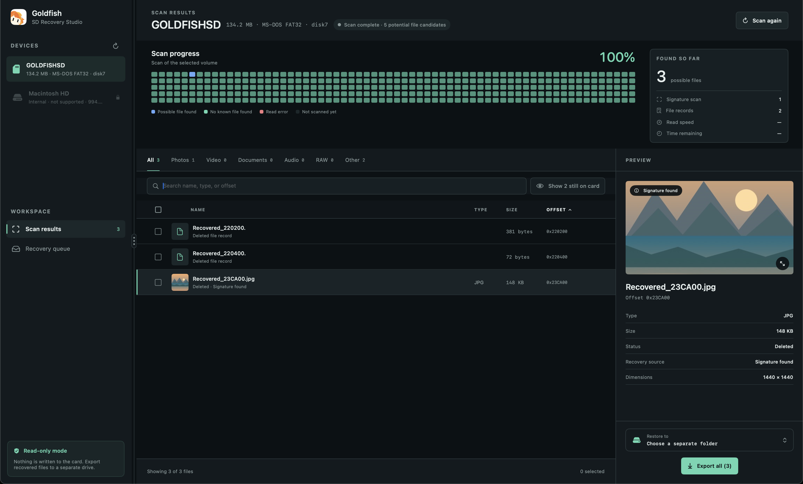
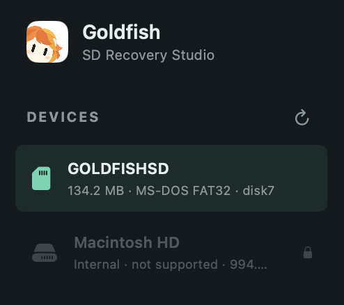
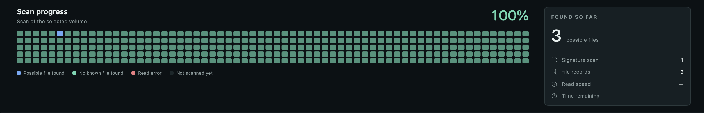
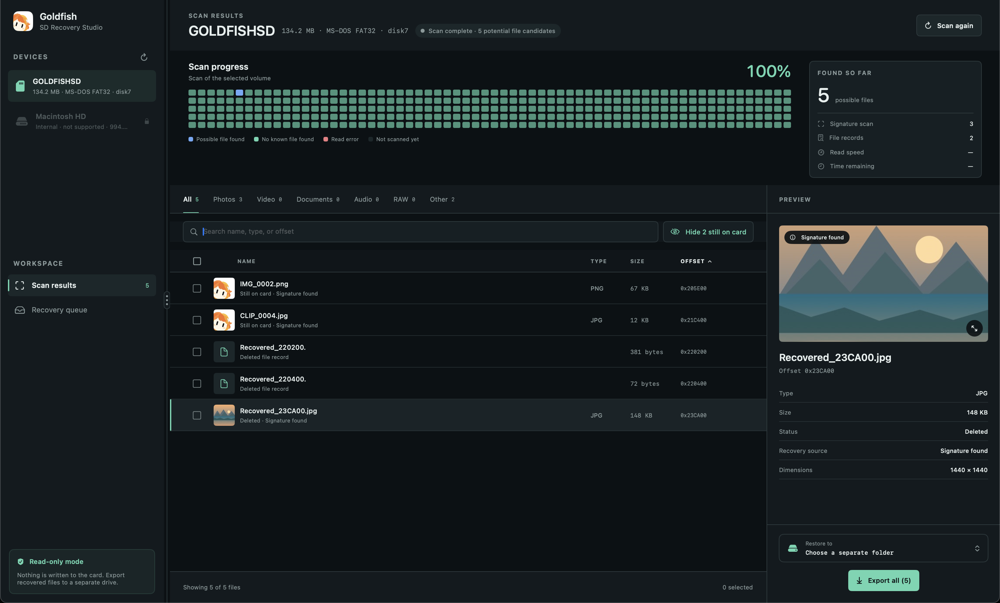
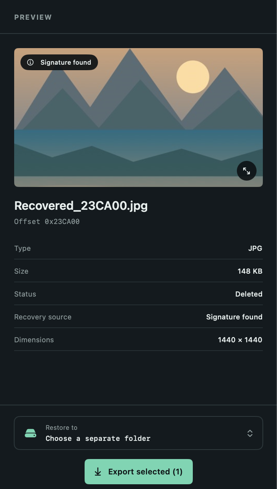
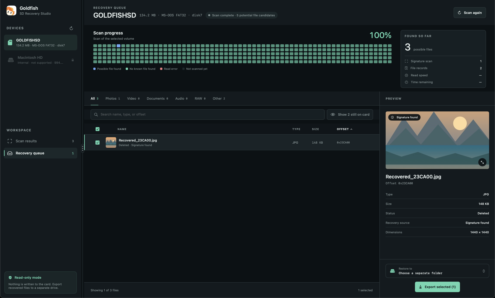
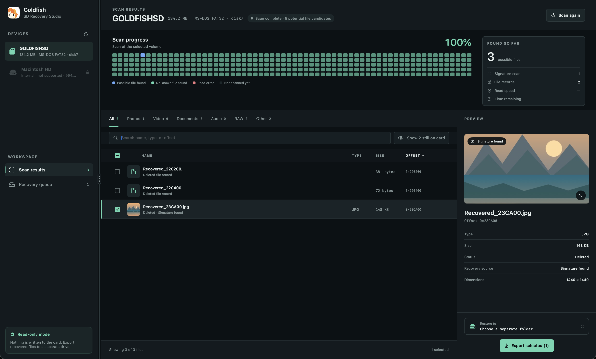

<p align="center">
  
</p>

<h1 align="center">Goldfish</h1>

<p align="center">
  <strong>Get back photos and videos you deleted from an SD card, without risking what's left on it.</strong><br>
  A native macOS app for Macs running macOS 14 Sonoma or later.
</p>

<p align="center">
  
</p>
<p align="center"><sub>Screenshots use a synthetic FAT32 demo card and illustrative sample files.</sub></p>

---

## Installing Goldfish

1. Download the latest `Goldfish-<version>-macOS.zip` from the [Releases](../../releases/latest) page.
2. Double-click the zip to unpack it, then drag **Goldfish** into your **Applications** folder.
3. Open it once using the steps below. After that, it opens normally like any other app.

The download works on both Apple silicon and Intel Macs running macOS 14 Sonoma or later.

### Why macOS blocks Goldfish the first time

Apple only lets an app open straight away if the developer has paid for an Apple Developer account and sent each version to Apple for an automated check, called *notarization*. Goldfish is a free, open-source project and isn't notarized. So the first time you open it, macOS shows a warning such as **"Goldfish" Not Opened** or **Apple could not verify "Goldfish" is free of malware**.

The warning means Apple hasn't checked this app. It doesn't mean anything wrong was found. Goldfish only reads your card, never connects to the internet, and all of its source code is in this repository for anyone to inspect. You can also [build it yourself](#build-and-run) instead of downloading it.

### Opening it the first time

**macOS 15 Sequoia and later**

1. Double-click **Goldfish** in Applications. When the warning appears, click **Done** (don't click **Move to Trash**).
2. Open **System Settings → Privacy & Security** and scroll down to the **Security** section.
3. You'll see *"Goldfish" was blocked to protect your Mac.* Click **Open Anyway**.
4. Enter your Mac password if asked, then click **Open Anyway** in the confirmation.

**macOS 14 Sonoma**

1. In Applications, **right-click** (or Control-click) **Goldfish** and choose **Open**.
2. Click **Open** in the warning.

**Using Terminal instead**

If you're comfortable with Terminal, this command removes the "downloaded from the internet" mark that triggers the warning:

```sh
xattr -dr com.apple.quarantine /Applications/Goldfish.app
```

You only need to do this once per version. After you install an update, macOS will ask again.

<details>
<summary>Checking your download (optional)</summary>

Each release includes a `.sha256` file. To confirm your download matches the one GitHub built, run this in the folder you downloaded to and compare the result with the contents of the `.sha256` file:

```sh
shasum -a 256 Goldfish-*-macOS.zip
```

</details>

---

## What is Goldfish?

When you delete a photo from a camera's memory card, or format the card, the picture usually isn't gone right away. The card only forgets *where* the photo was. The photo itself stays on the card until something new is saved over it.

Goldfish reads your card, finds those forgotten files, and lets you save copies to your Mac. It **only reads** the card and never changes anything on it, so using Goldfish can't make your situation worse.

Goldfish is built for the cards used in cameras, drones, action cameras and phones: SD, microSD and similar cards formatted as **exFAT** or **FAT32**, which is nearly all of them.

> [!IMPORTANT]
> **Stop using the card now.** Don't take new photos, copy files onto it, or format it. Anything new saved to the card can overwrite the files you want back. Put it somewhere safe until you're ready to recover.

---

## Features

### Finds your card and nothing else

Insert your card and it appears in the sidebar, with its size and format. Your Mac's own drives are listed but locked, so you can't scan the wrong disk by mistake. Cards work in the Mac's built-in SD slot and in USB card readers.

<p align="center"></p>

### Watch the scan as it happens

Goldfish reads the whole card from start to finish. A map shows which parts have been read and where files were found, alongside the read speed and the time remaining. Found files appear as soon as they're discovered, so you can start looking while the scan is still running.

<p align="center"></p>

| Map colour | Meaning |
|---|---|
| Blue | Part of the card where Goldfish found a possible file |
| Green | Read successfully, but no recognisable file there |
| Red | The card couldn't read this part (possible damage) |
| Dark | Not read yet |

### Browse, search and sort what was found

Results are sorted into **Photos**, **Video**, **Documents**, **Audio**, **RAW** (camera raw files) and **Other**. You can search by name or type, and sort by name, type, size or position on the card.

Files that were never deleted (they're still on the card normally) are hidden by default, so the list shows what actually needs recovering. Click **Show … still on card** to include them.

<p align="center"></p>

### Check each file before you save it

Select a file to see a preview and its details. For photos, that includes the camera, lens, date taken, exposure settings and image size, when the card still has them. Click the preview to open a larger view.

<p align="center">
  
  &nbsp;
  
</p>

When the card still records a deleted file's original name (for example `DSCF0421.JPG`), Goldfish uses it. Otherwise the file gets a name based on where it was found, such as `Recovered_10F30C0.jpg`.

### Pick what to save, then save it somewhere safe

Tick the files you want. They collect in the **Recovery queue**. Choose a folder under **Restore to**, then click **Export selected**, or **Export all** if nothing is ticked.

Goldfish sorts exported files into folders such as `Photos`, `Videos` and `Camera RAW`. It never overwrites a file that's already there: a second `IMG_0001.jpg` becomes `IMG_0001 (1).jpg`. It also won't let you save onto the card you're recovering from.

<p align="center"></p>

### Safe by design

- **Read-only.** Goldfish opens the card for reading only. It never writes, repairs or formats anything.
- **Private.** Everything happens on your Mac. Goldfish doesn't connect to the internet and doesn't upload your files anywhere.
- **Careful with damaged cards.** If parts of a card can't be read, Goldfish skips just those parts and slows down to reading one area at a time, which puts less strain on a failing card.

---

## How to recover your files

1. **Stop using the card** (see the warning above).
2. **Insert the card** into your Mac's SD slot or a card reader.
3. **Open Goldfish** and select the card in the sidebar. If it's missing, click the refresh button next to **Devices**.
4. **Click Start safe scan.** A 64 GB card takes roughly 10–15 minutes; the time depends mostly on how fast your card is.
5. **Browse the results.** Use the tabs and the preview to find the files you want.
6. **Tick the files you want**, or tick none to export everything.
7. **Choose a folder under Restore to.** Pick a folder on your Mac or on another drive, not on the card.
8. **Click Export.** When it finishes, open the folder to check your files.

Keep the card in the Mac until the export is finished, because Goldfish reads each file straight from the card as it saves it.

---

## Giving Goldfish access to your card

macOS protects storage devices. The first time you scan, you may see **SD card access needed**. Nothing on the card has been changed; macOS just needs your permission.

1. Click **Authorize device access** and enter your Mac password. This adds your account to macOS's built-in *operator* group, which is allowed to read storage devices.
2. Click **Try scan again**.
3. If it still doesn't work, sign out of your Mac and back in (or restart), then try again. macOS sometimes only applies the change after that.

**Full Disk Access** (the other button in the dialog) covers files on your Mac. Reading a card directly is a separate permission, so Full Disk Access alone usually isn't enough.

---

## What Goldfish can recover

Goldfish finds files in two ways, and uses both on every scan.

**1. By recognising the file itself.** Many file types have a recognisable structure. Goldfish can find these even after the card has been formatted, and works out exactly where each file ends:

| Kind | Formats |
|---|---|
| Photos | JPEG, PNG, GIF |
| Camera RAW | TIFF-based RAW files, e.g. Nikon NEF, Sony ARW, Canon CR2, DNG |
| Video | MP4, most MOV, MKV |
| Documents | PDF |

**2. By reading the card's deleted file records.** exFAT and FAT32 cards keep a record of each file, and deleting a file often leaves that record behind. Goldfish uses those leftovers to recover files of **any type**, including audio, text and other files it can't recognise, as long as the record and the data are still there.

Each file shows where it came from:

| Label | What it means |
|---|---|
| **Signature found** | Goldfish recognised the file's own structure. |
| **Deleted file record** | The card's own record says exactly where the file is. |
| **Deleted record · data order assumed** | The record survived, but the card had cleared the map of where the file's pieces are. Goldfish assumes the pieces are stored in order. This is usually right for photos, but can produce a damaged file if the card stored it in scattered pieces. |

And its status on the card:

| Status | What it means |
|---|---|
| **Deleted** | The file was deleted and can be recovered. |
| **No file record** | No record points to it, e.g. after formatting. Recovered from the data alone. |
| **Still on card** | Never deleted; you can copy it normally. Hidden unless you choose to show it. |

### What it can't do

- **Overwritten files are gone.** If new photos were saved over the same space, the old ones can't come back.
- **Some formats aren't recognised yet**, including HEIC photos and some RAW formats such as Fujifilm RAF. These can still come back through deleted file records, but not after the card has been formatted.
- **Your Mac's internal drive isn't supported.** Modern Macs encrypt their drives and clear deleted space, so recovery tools rarely work there anyway.
- **A found file isn't always complete.** A file that was partly overwritten can open damaged or not at all. Check your files after exporting.
- **Missing a file doesn't prove it's gone for good.** If something important isn't found, a professional recovery service may still be able to help.

---

## FAQ

**Is it safe to use on my only copy of my photos?**
Yes. Goldfish only reads the card and never writes, repairs or formats it. Export to a folder on your Mac or on another drive, never back to the card.

**Why are there so many small `.jpg` files?**
Cameras store a small preview image inside each photo and RAW file. Goldfish recognises most of these and attaches them to the main photo, but some still show up on their own. Sort by **Size** to bring the full-size photos to the top.

**The scan found files I never deleted. Why?**
Those are files that are still on the card normally. They're hidden unless you click **Show … still on card**.

**Can I scan more than once?**
Yes. Scanning only reads the card, so you can scan as often as you like.

**Where are the logs?**
In `~/Library/Logs/Goldfish/debug.log`. Include this file if you report a problem.

---

## For developers

### Build and run

Requires macOS 14+ and Swift 6 (Xcode 16 or the matching command-line tools).

```sh
swift run Goldfish            # debug build and run
Scripts/run-debug.sh          # debug run, console output also saved to goldfish-debug.log
Scripts/build-app.sh          # release build, packaged as build/Goldfish.app
```

`Scripts/build-app.sh` also accepts `UNIVERSAL=1` (build for both arm64 and x86_64) and `VERSION=1.2.3` (stamp the version into the bundle's `Info.plist`).

The app bundle is signed ad hoc, so on another Mac Gatekeeper will block it the first time (see [Installing Goldfish](#installing-goldfish)).

### Publishing a release

Pushing a version tag runs `.github/workflows/release.yml`. It runs the tests, builds a universal app stamped with the tag's version, and publishes a GitHub release with the zip and its SHA-256 checksum attached:

```sh
git tag v0.2.0
git push origin v0.2.0
```

A tag with a suffix, such as `v0.2.0-beta.1`, is published as a pre-release.

App metadata and the icon live in `Packaging/`. The supplied icon artwork is in `AppIcons/`, and `Scripts/prepare-app-icon.swift` regenerates the `.icns`. See `AGENTS.md` for the icon sizing rules.

### Tests

```sh
swift test
```

The suite uses small synthetic FAT32 and exFAT images and runs in a couple of seconds with no hardware. Two hardware tests only run when you opt in:

```sh
# Full scan of a real card or disk image, with timing
GOLDFISH_BENCH_DEVICE=/dev/rdisk4s1 swift test -c release -Xswiftc -enable-testing --filter ScanBenchmark

# Ejects and re-attaches disk images to check card-removal handling
GOLDFISH_CARD_REMOVAL_TEST=1 swift test --filter CardRemoval
```

### Read-speed benchmark

Compares 1, 2 and 4 parallel readers on a connected card. It only reads.

```sh
diskutil list external physical
Scripts/benchmark-read.py /dev/rdisk4s1 --sample-mib 1024
```

Replace `/dev/rdisk4s1` with the card's partition from `diskutil`.

### How it works

| Area | Files |
|---|---|
| Device discovery (`diskutil`) | `Sources/Goldfish/Engine/DeviceProvider.swift` |
| Raw, read-only device access and chunk cache | `Sources/Goldfish/Engine/RawDevice.swift` |
| Parallel scan, carving and merging results | `Sources/Goldfish/Engine/RecoveryEngine.swift` |
| Per-format size parsers | `Sources/Goldfish/Engine/FormatCarvers.swift` |
| FAT32 / exFAT directory and deleted-entry recovery | `Sources/Goldfish/FileSystem/` |
| App state, export | `Sources/Goldfish/UI/RecoveryModel.swift` |
| Interface | `Sources/Goldfish/UI/` |

A scan splits the card into 64 MB sections, and up to four workers read them in parallel, 4 MB at a time. Each block is searched for file signatures; each match is parsed to find the file's exact end. At the same time, the FAT32 or exFAT directory is read to name the files that are found and to recover deleted files by their records. If the card reports a read error, the scan finishes the sections already running and reads the rest one section at a time.
